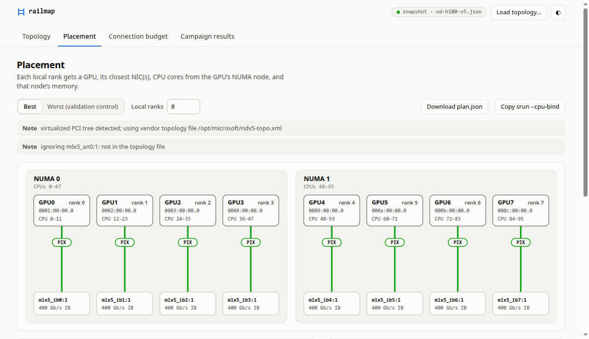

# railmap

<picture>
  <source media="(prefers-color-scheme: dark)" srcset="docs/placement-dark.png">
  
</picture>

<sub><code>railmap ui</code> on the ND H100 v5 test fixture (Azure's published topology file and a simulated VM).
More views in <a href="docs/ui.md">docs/ui.md</a>.</sub>

Places each rank of a multi-GPU job on the right NIC, CPU cores and NUMA memory. Also warns when a collective job
will open more RDMA connections per NIC than the NIC handles well.

It targets three gaps in multi-GPU / multi-NIC scaling guidance:

1. **Placement.** Each GPU needs a nearby NIC (PIX/PXB), and cross-socket (SYS) paths hurt. Launchers, containers
   and `CUDA_DEVICE_ORDER` mistakes still put ranks on the wrong NIC or socket. On cloud VMs the guest PCI tree is
   virtualized, so `nvidia-smi topo -m` and sysfs can't show the real layout.
2. **Queue sharding.** No published guidance says how many QPs each GPU should get on a shared NIC, or how to
   spread them across several nearby NICs.
3. **Connection state.** All-to-all RDMA reportedly loses about 59% of a NIC's message rate at about 3,000
   connections, and nothing warns a job before it gets there.

## Quick start

```bash
uv sync
uv run railmap plan                         # per-rank GPU, NIC, CPUs, NUMA node
uv run railmap plan --nodes 128             # ...plus the QP-per-NIC budget for a 128-node all-to-all
torchrun --nproc-per-node 8 --no-python railmap exec -- python train.py   # bind each rank, then exec
uv run railmap ui                           # the same, as a local web page
```

## Status

Findings are pending the [Azure ND H100 v5 campaign](docs/measurements.md#azure-campaign). Until it measures a NIC,
the connection budget uses a one-point prior built from the 59% / 3,000 figure.

## Docs

- [Usage](docs/usage.md): every command, topology sources, job options, and what `exec` sets.
- [UI](docs/ui.md): the four views of `railmap ui`.
- [Measurements](docs/measurements.md): the probes and the Azure campaign.
- [How it works](docs/design.md): path classes, NIC assignment, the QP model, and tests.
