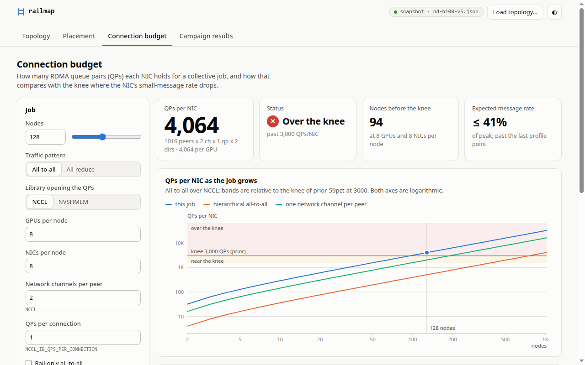
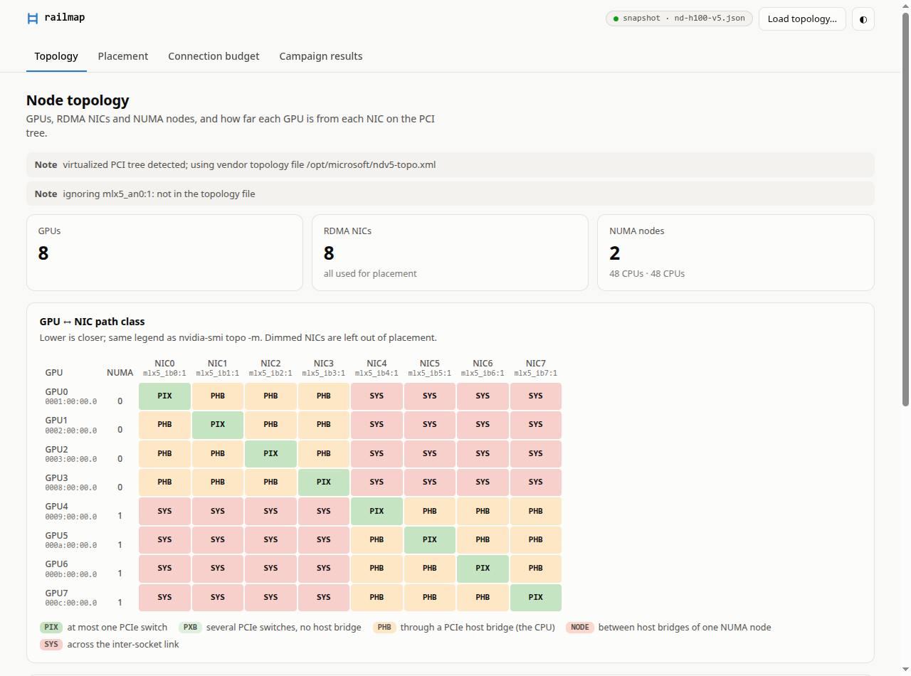

# UI

```bash
uv run railmap ui                           # http://localhost:8765/, opens a browser tab
uv run railmap ui --snapshot topo.json      # plan offline for another machine
uv run railmap ui --topo-file tests/fixtures/azure-ndv5-topo.xml   # the ND H100 v5 fixture, as in the screenshots
```

<table>
  <tr>
    <td width="50%">
      <picture>
        <source media="(prefers-color-scheme: dark)" srcset="budget-dark.png">
        
      </picture>
    </td>
    <td width="50%">
      <picture>
        <source media="(prefers-color-scheme: dark)" srcset="topology-dark.png">
        
      </picture>
    </td>
  </tr>
</table>

The page has four views:

- **Topology:** the GPU×NIC path-class matrix, NICs and NUMA nodes.
- **Placement:** a diagram of each rank's GPU, NIC and CPUs (best or worst variant), each rank's environment, and a
  `plan.json` download.
- **Connection budget:** QPs per NIC as the job grows, against the NIC profile's knee, with the settings that would
  lower it.
- **Campaign results:** everything under `--results` (default `results/`): the GDR matrix, the QP knee, the model
  against observed QPs, and placement validation.

To plan offline, drop a `show --save` JSON or an NCCL topology XML onto the page. The server listens on 127.0.0.1;
from a remote node, run `ssh -L 8765:localhost:8765 <node>` and open the same URL.
